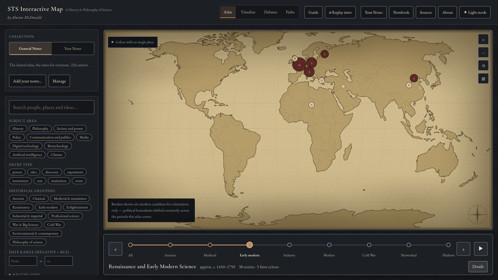
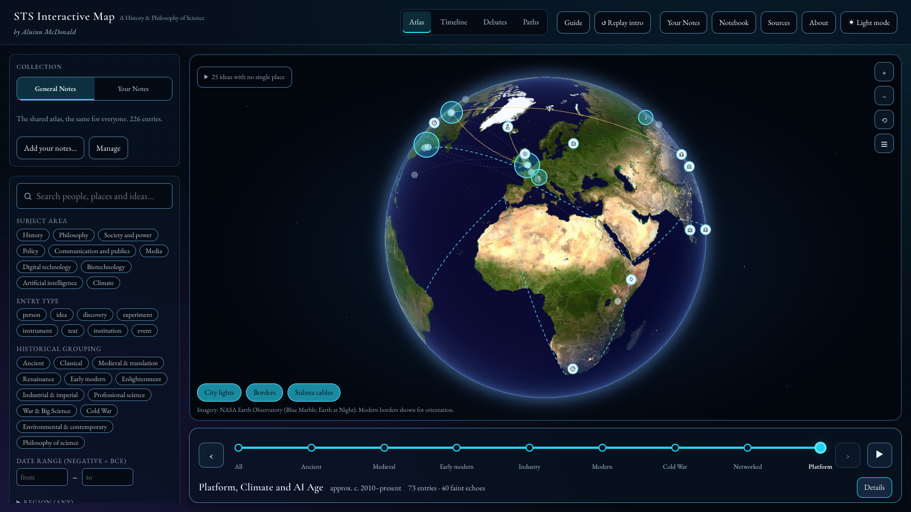
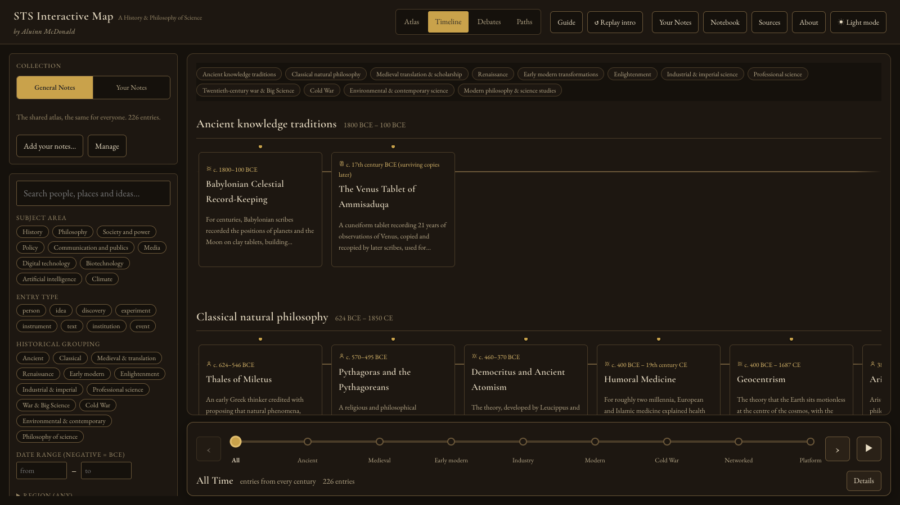
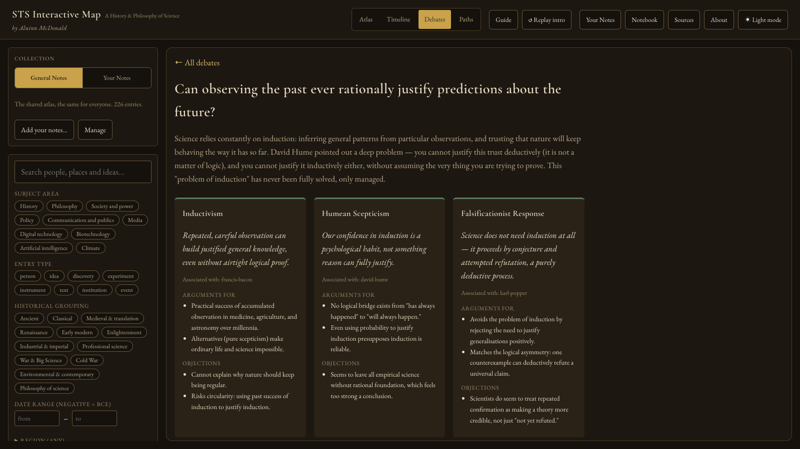
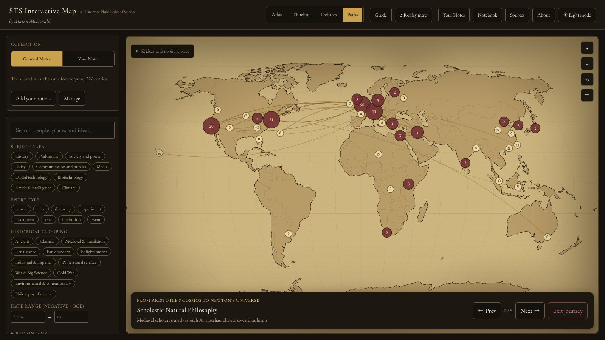
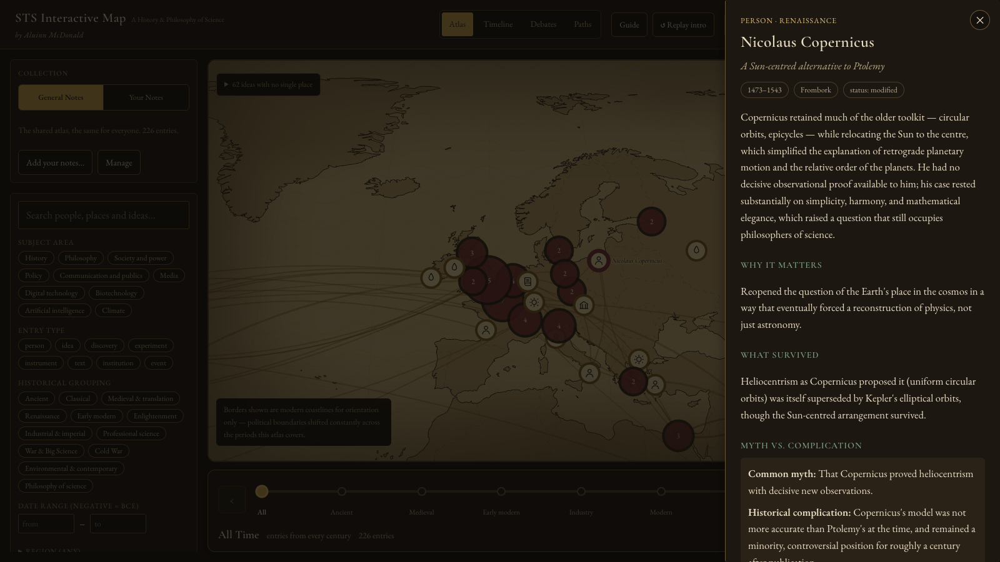
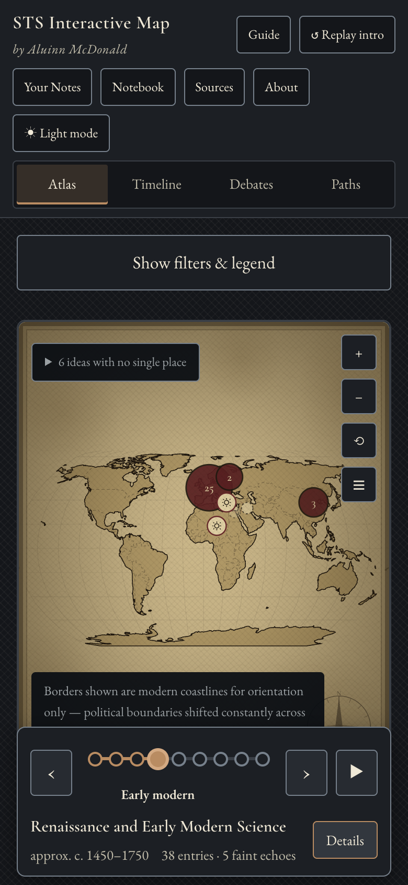
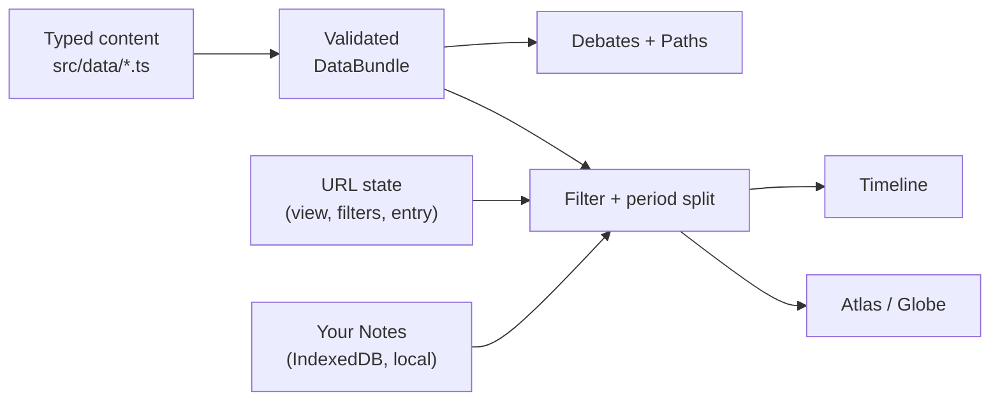

<div align="center">

# STS Interactive Map

**An interactive atlas of how scientific ideas travelled between cultures, cities and centuries, with the philosophy of science kept in the same frame.**

[](https://github.com/aluinn/STS-interactive-map/actions/workflows/ci.yml)
[](https://github.com/aluinn/STS-interactive-map/actions/workflows/codeql.yml)
[](LICENSE)
[](https://github.com/aluinn/STS-interactive-map/stargazers)
[](https://vercel.com/new/clone?repository-url=https%3A%2F%2Fgithub.com%2Faluinn%2FSTS-interactive-map)



<!-- HERO VIDEO: the line below is the screen recording already linked in the previous README.
     GitHub renders a bare user-attachments URL as an inline video. To use a GIF instead,
     put it at docs/assets/demo.gif and swap it for the image above. -->

https://github.com/user-attachments/assets/20be2ade-4bb6-4c8a-a16b-585e517022f4

[**Live demo**](https://sts-interactive-map.vercel.app/) · [Architecture](docs/ARCHITECTURE.md) · [Roadmap](ROADMAP.md) · [Contributing](CONTRIBUTING.md)

</div>

> "Knowledge has never travelled in a straight line."

STS Interactive Map is not a timeline of "great discoveries". It tries to map the messier
shape of how scientific knowledge moved (through translation, argument, trade, empire,
craft, experiment, exclusion and collaboration) and to read that movement critically using
philosophy of science. It began as a portfolio project alongside a History and Philosophy
of Science course at UCL and is designed to grow into a larger digital-humanities resource.

## Features

- **Atlas**: a parchment-style map of 226 entries (people, ideas, discoveries, experiments,
  instruments, texts, institutions, events) with clustered markers and curved routes for
  164 documented relationships (influenced, translated, criticised, excluded, funded and
  more). A list view gives every entry as a keyboard- and screen-reader-friendly list.
- **Period slider**: eight periods from Ancient Worlds to the Platform, Climate and AI Age.
  Each re-themes the interface, shows entries inside the period, and fades in "echoes" from
  outside it. The latest period swaps the map for a satellite-style globe.
- **Timeline**: the same entries grouped into flexible historical periods, deliberately
  not one march of progress.
- **Debates**: 20 philosophy-of-science disputes (induction, falsifiability, paradigms,
  realism, values in science and more) shown as positions, arguments for and objections,
  linked to historical cases.
- **Paths**: 29 guided journeys that step through entries one at a time, with a caption
  explaining why each stop connects to the next.
- **Your Notes**: drop in your own PDFs, `.txt` or `.md` notes and get a private personal
  atlas on its own map. Everything is read on your device with rules and dictionaries; no
  AI service, no upload ([details](docs/MY_NOTES.md)).
- **Honest content model**: entries carry confidence levels, "common myth vs complication"
  notes, theory status ("modified", "superseded") and typed sources; a test fails the
  build if an entry has no source and is not marked `sourceNeeded`.
- **Shareable state**: view, selection, period and filters live in the URL, so any screen
  can be linked. Filters cover search, subject area, entry type, historical grouping, date
  range, region and evidence status.
- **Extras**: first-visit guided tour, cinematic intro, notebook for saved entries
  (stored in your browser), dark and light themes, reduced-motion support.

## Screenshots

| Atlas (Renaissance and Early Modern) | Globe (Platform, Climate and AI Age) |
| :---: | :---: |
|  |  |
| **Timeline** | **Debates** |
|  |  |

<details>
<summary>More screenshots</summary>

| Paths | Entry detail | Phone (390 × 844) |
| :---: | :---: | :---: |
|  |  |  |

</details>

## How it works



1. **All content is typed TypeScript** in `src/data/`, bundled with the app. There is no
   backend, database or API key.
2. **One validated bundle feeds every view.** A test checks unique ids, dangling
   references, plausible years and coordinates, and that every entry is sourced.
3. **The URL is the state.** Filters, view, period and selection are query parameters, so
   Back/Forward and shared links just work.
4. **Notes stay on your device.** PDF text is extracted in a web worker, analysed by
   deterministic rules, reviewed by you, and only accepted items are saved to IndexedDB.

More in [`docs/ARCHITECTURE.md`](docs/ARCHITECTURE.md).

## Quick start

Requires Node.js `^20.19.0` or `>=22.12.0`.

```bash
git clone https://github.com/aluinn/STS-interactive-map.git
cd STS-interactive-map
npm install
npm run dev     # http://localhost:5173
```

| Command | What it does |
| --- | --- |
| `npm run dev` | Start the Vite dev server |
| `npm run build` | Typecheck and build to `dist/` |
| `npm run preview` | Serve the production build locally |
| `npm run lint` / `npm run typecheck` | ESLint / `tsc -b` |
| `npm test` | Unit and component tests (Vitest) |
| `npm run test:e2e` | Playwright smoke test against the production build |
| `npm run format` | Prettier |
| `npm run screenshots` | Regenerate `docs/assets/screenshot-*.png` |
| `npm run perf` | Print the timings quoted in [`docs/PERFORMANCE.md`](docs/PERFORMANCE.md) |

## Deploy

The app is a static build (`npm run build` produces `dist/`) and needs no environment
variables, so any static host works: Vercel, Netlify, GitHub Pages, Cloudflare Pages. The
live site is on Vercel; the button at the top clones the repo into your own project.
The production build adds a Content-Security-Policy meta tag (`connect-src 'self'`).

## FAQ

**Is it finished or complete?** No. It is an interpretive, educational project with a
deliberately selective dataset, not a neutral or exhaustive account. The in-app About page
says so.

**Why are there country borders if the periods are centuries apart?** They are modern
borders drawn for orientation only, and the map says that. Coastlines and borders come
from Natural Earth.

**Does "Your Notes" send my files anywhere?** No. There is no backend; the production CSP
blocks requests to other origins, and a test plus an offline browser check
(`npm run verify:import`, which needs a Playwright browser installed and is not run in CI) guard against regressions. Saved
collections sit unencrypted in your browser's IndexedDB, and the interface says so. See
[`docs/MY_NOTES.md`](docs/MY_NOTES.md).

**Does it use AI?** No. Note analysis is rules and dictionaries, so it is explainable but
less clever than a language model, and unsure items are flagged for your review.

**Are the subsea cables on the globe accurate?** No, they are schematic corridors, not
the surveyed paths of individual cables.

**Is anything loaded from a third party?** Two Google Fonts stylesheets. Everything else is
bundled or served from the same origin ([roadmap](ROADMAP.md) item to self-host them).

**Is the whole dataset in the bundle?** Yes, which makes the main JavaScript chunk about
1 MB (about 310 kB gzipped). See [`docs/PERFORMANCE.md`](docs/PERFORMANCE.md).

**Are the "knowledge routes" in the data visible?** Not yet. Seven validated routes exist
in the data but no view shows them
([draft issue](docs/issues/06-render-knowledge-routes.md)).

**Can I add content?** Yes; see [CONTRIBUTING.md](CONTRIBUTING.md) and
[`CONTENT_GUIDE.md`](CONTENT_GUIDE.md). Never invent a citation: mark it `sourceNeeded`.

## Good first issues

Scoped drafts live in [`docs/issues/`](docs/issues/); copy one into a new GitHub issue to
get started.

| Issue | Labels |
| --- | --- |
| [Add Open Graph and social-preview meta tags](docs/issues/01-og-meta-tags.md) | good first issue |
| [Unit-test the easing helpers](docs/issues/02-tests-easing-utils.md) | good first issue |
| [Unit-test `areas.ts` region and area logic](docs/issues/03-tests-areas-regions.md) | good first issue |
| [Generate the counts in CONTENT_AUDIT.md from the data](docs/issues/04-generate-content-audit-counts.md) | good first issue |
| [E2E test: step through a guided path](docs/issues/05-e2e-paths-view.md) | good first issue |
| [Show knowledge routes in the Atlas](docs/issues/06-render-knowledge-routes.md) | enhancement |
| [Split the dataset out of the main bundle](docs/issues/07-split-dataset-bundle.md) | enhancement |
| [Self-host the fonts and tighten the CSP](docs/issues/08-self-host-fonts.md) | enhancement |
| [Automated accessibility checks in CI](docs/issues/09-a11y-axe-ci.md) | enhancement |
| [Label-collision layout for Atlas markers](docs/issues/10-atlas-label-collision.md) | enhancement |

## Roadmap

See [ROADMAP.md](ROADMAP.md).

## Credits

- **Author:** [Aluinn McDonald](https://github.com/aluinn)
- **Globe imagery:** [NASA Earth Observatory](https://earthobservatory.nasa.gov/): *Blue
  Marble* and *Earth at Night* (resized; no NASA endorsement implied)
- **Coastlines and borders:** [Natural Earth](https://www.naturalearthdata.com/) via
  [`world-atlas`](https://github.com/topojson/world-atlas)
- **Libraries:** [React](https://react.dev/), [Vite](https://vitejs.dev/),
  [D3](https://d3js.org/), [TopoJSON](https://github.com/topojson/topojson-client),
  [PDF.js](https://mozilla.github.io/pdf.js/) (Mozilla, Apache-2.0),
  [Vitest](https://vitest.dev/), [Playwright](https://playwright.dev/)
- **Fonts:** [Cormorant Garamond](https://fonts.google.com/specimen/Cormorant+Garamond)
  and [EB Garamond](https://fonts.google.com/specimen/EB+Garamond) via Google Fonts
- **Context:** built alongside a History and Philosophy of Science course at UCL

Cite this project with [`CITATION.cff`](CITATION.cff) (GitHub's "Cite this repository").

## Licence

[MIT](LICENSE) © 2026 Aluinn McDonald
