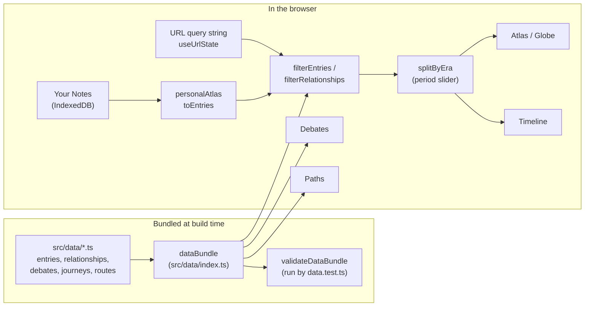
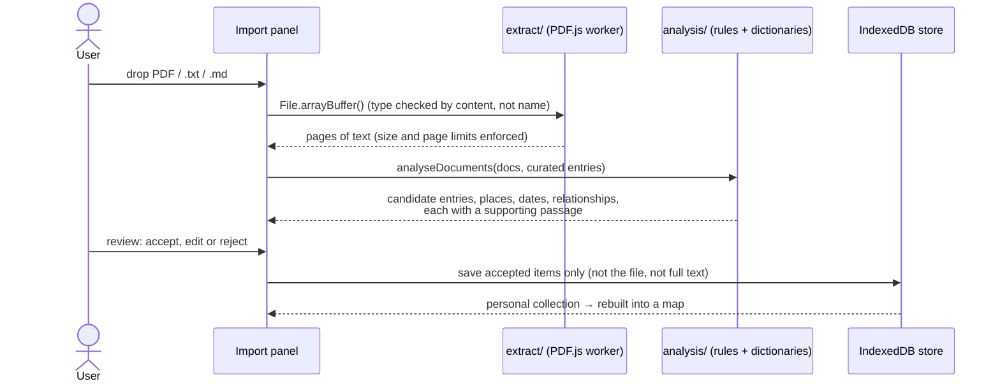

# Architecture

STS Interactive Map is a static single-page app: React 19 + TypeScript + Vite, with D3
for geometry. There is no backend and no network call for content; the whole dataset
ships inside the JavaScript bundle. This document explains how the pieces fit and why
they are shaped the way they are.

## Data flow

- **One bundle, many views.** Every view consumes the same typed `DataBundle`
  (`src/types/index.ts`). Nothing in rendering code knows the data is local TypeScript,
  so a CMS or database could replace `src/data/index.ts` without touching components.
- **The URL is the state store.** View, selected entry/debate/journey/stop, period and
  every filter live in the query string (`src/hooks/useUrlState.ts`). Navigation changes
  `pushState` so Back/Forward work; filter-only changes `replaceState` so typing in
  search does not flood history. A copied link reproduces the screen.
- **Two collections, never mixed silently.** "General Notes" is the curated dataset.
  "Your Notes" is a personal atlas rebuilt from the user's own imports and shown on its
  own map; curated entries that the notes mention are linked, not duplicated.
- **Period-aware display.** `splitByEra` divides the filtered entries into those inside
  the selected period and faint "echoes" outside it. The latest period (Platform,
  Climate and AI Age) swaps the SVG map for a canvas globe.

## Key sequence: importing notes

No step involves the network. See [`MY_NOTES.md`](MY_NOTES.md) for what is stored and
how each privacy promise is checked.

## Folder map

| Path | What lives there |
| --- | --- |
| `src/data/` | All content, split by period (`entries.*.ts`), plus relationships, debates, journeys, knowledge routes. `index.ts` assembles the `DataBundle`. |
| `src/types/` | The content model (`Entry`, `Relationship`, `Debate`, `Journey`, `KnowledgeRoute`). See [`DATA_MODEL.md`](../DATA_MODEL.md). |
| `src/features/atlas/` | SVG map (D3 projection and zoom), markers, curved routes, cluster side panel, accessible list fallback. |
| `src/features/globe/` | Canvas globe for the latest period; textures sampled directly, no WebGL or 3D library. |
| `src/features/{timeline,debates,journeys}/` | The other three views. |
| `src/features/eras/` | Period model of the interface: slider, per-period themes applied as CSS custom properties, decoration. |
| `src/features/notes/` | "Your Notes": extraction, analysis, review UI, storage, exports. |
| `src/features/walkthrough/` | First-visit guided tour and quick reference. |
| `src/components/` | Shared shell: navigation, detail panel, modal, search and filters, cinematic intro. |
| `src/hooks/`, `src/utils/` | URL state, theme, notebook (localStorage), geometry, filtering, validation, contrast maths. |
| `src/tests/` | Vitest unit and component tests. |
| `e2e/` | Playwright smoke test. |
| `scripts/` | Screenshot capture, benchmark, offline-import verification. |
| `public/earth/` | Two NASA texture JPEGs for the globe. |

## Decisions and trade-offs

- **Content as typed TypeScript, not JSON or a database.** The compiler checks every
  field, and `validateDataBundle` checks what types cannot (unique ids, dangling
  references, year ranges, "every entry has a source unless marked `sourceNeeded`").
  The cost: contributors edit `.ts` files and the dataset is part of the main bundle
  (see [`PERFORMANCE.md`](PERFORMANCE.md)).
- **Deterministic notes analysis instead of an AI service.** Rules and dictionaries are
  less clever than a language model, but nothing leaves the device, results are
  reproducible and explainable (each item keeps its supporting passage), and the app needs
  no key or backend. Unsure items are flagged for review rather than guessed.
- **Canvas globe without WebGL or Three.js.** `renderEarth.ts` samples the textures
  per pixel on the CPU, drops to half render quality while the globe is being dragged,
  and keeps a half-size texture copy to avoid shimmer when drawn small. This avoids a
  large dependency and WebGL fallbacks, at the cost of more CPU work per frame.
- **Coastlines plus faint modern borders, with a disclaimer.** The map says in-app that
  borders are modern and for orientation only, because political boundaries shifted
  constantly across the periods covered.
- **Production CSP.** `vite.config.ts` injects `connect-src 'self'` into the built HTML
  only (dev needs Vite's WebSocket), so the browser itself blocks a request that would
  send text elsewhere.
- **Relationships must be documented.** The model has typed, directional edges with a
  one-sentence justification and a confidence level; shared topic or period is expressed
  separately and implies no influence.

## Failure modes

| What goes wrong | What happens | Where handled |
| --- | --- | --- |
| IndexedDB unavailable (some private modes) | In-memory store; the UI says collections will not survive a reload | `features/notes/storage/store.ts` |
| localStorage blocked or corrupt (theme, notebook, tour state) | Falls back to defaults; the tour is offered once per visit | `hooks/useNotebook.ts`, `features/walkthrough/storage.ts` |
| Corrupt or newer-version saved collection | Skipped and reported, others still load | `LoadReport.skipped` in `store.ts` |
| Scanned (image-only) PDF | No text to extract; flagged as probably scanned | `extract/` (`scanned` flag) |
| Very large file or page count | Limits enforced; `truncated` flag shown | `extract/index.ts` (`DEFAULT_LIMITS`) |
| File that is not what its name says | Type decided by content, not extension | `extract/index.ts` |
| Unknown or malformed URL parameter | Falls back to the default view or empty filter | `useUrlState.ts` (`parseState`) |
| Texture download fails | The globe view records the failure (`textureFailed`) and a later attempt can retry; textures are otherwise preloaded one period early | `globe/earthTextures.ts`, `GlobeView.tsx` |
| Reduced-motion preference | Animated transitions replaced with instant jumps | `hooks/usePrefersReducedMotion.ts` |
| Dangling id or missing source in content | Test failure in CI | `utils/validateData.ts`, `tests/data.test.ts` |

## Accessibility

- The map has a list-view toggle: every filtered entry as a keyboard- and
  screen-reader-navigable list.
- Markers, routes and clusters are focusable with descriptive `aria-label`s and respond
  to Enter/Space.
- The detail panel and modals are `role="dialog"`, trap focus, close on Escape and
  restore focus.
- `prefers-reduced-motion` is respected; period themes are checked with a contrast
  helper (`utils/contrast.ts`, `tests/eraTheme.test.ts`).

## Testing

Vitest covers data integrity, filtering, URL state, period logic, notes analysis,
collection handling and the privacy rules (including a source scan that fails the build
if network, AI-provider or `innerHTML` code appears in the notes feature). One
Playwright smoke test exercises the production build. CI runs everything on each push.
